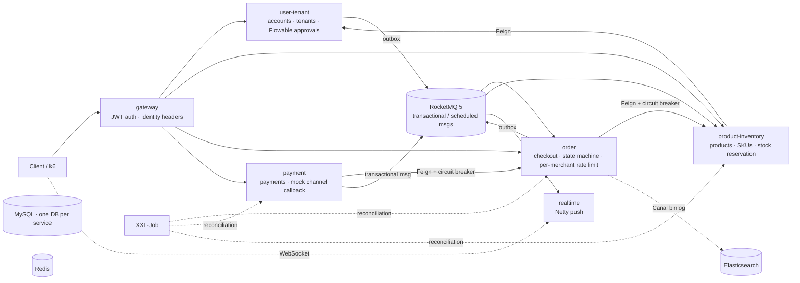

# MerchantHub

[](https://github.com/shqyecho6868-code/merchanthub/actions/workflows/ci.yml)

[中文](README.md) | **English**

Backend of a multi-merchant (multi-tenant) e-commerce trading platform. Tenancy is platform → merchant → staff, with buyers as platform-level users. Covers products & SKUs, inventory reserve / confirm / release, an order state machine with trade snapshots, mock payments with callbacks, Flowable approvals, real-time order push over Netty, order search on Elasticsearch, and reconciliation jobs. A learning project rebuilt from a distributed IM system; the focus is on **the engineering practices behind transactional consistency and tenant isolation**. No frontend.

## Architecture



Sequence diagrams (checkout & reservation, 4-layer callback idempotency, payment-vs-timeout race, push routing) are in [docs/architecture.md](docs/architecture.md) (Chinese).

## Highlights

### 1. Order consistency
- **Reserve → confirm → release** inventory: conditional `UPDATE ... WHERE available >= ?` prevents overselling; multi-SKU rows are locked in ascending ID order to avoid deadlocks; a unique key on `(order_no, sku_id)` makes reservation idempotent
- **State-machine CAS**: every transition is `UPDATE ... WHERE status = <old>` plus a status-log row in the same transaction; when payment success and timeout-close race, exactly one wins
- **Reliable events**: transactional outbox on the order side, RocketMQ transactional messages (half message + check-back) on the payment side; consumers dedupe by eventId inside the business transaction
- **4-layer callback idempotency**: payment fast path → payment CAS → consumer dedupe → order CAS; money arriving after the order is closed goes to `pay_anomaly` instead of resurrecting the order
- **Safety nets**: dangling-reservation scanner and payment ↔ order / reservation ↔ order reconciliation (XXL-Job); fixes go through the normal idempotent path
- Amounts in `long` cents, orders separate from payment attempts, trade snapshots, Snowflake order numbers (workerId leased from Redis)

### 2. Multi-tenancy
- The gateway parses the JWT, **strips client-supplied identity headers**, then injects `X-Tenant-Id / X-User-Id / X-Role`; `/internal/**` is never exposed
- `TenantContext` propagates across Web / Feign / MQ / scheduled jobs; a MyBatis-Plus tenant interceptor appends `tenant_id` automatically and **fails closed when no context is set**
- Endpoint-level RBAC via `@RequireRole`; cross-tenant access returns 404 (does not leak existence)
- Sentinel hot-parameter rate limiting per merchant: a big merchant exhausts only its own quota
- Merchant onboarding and product listing go through Flowable approvals, with to-do lists isolated by tenant candidate groups

### 3. Real-time push
- Netty WebSocket with JWT check at handshake; a Redis hash with per-field TTL is the "user → node" routing table
- Order events are consumed in cluster mode and forwarded to the owning node (Tag = node), so pushes reach the right connection with multiple instances
- **Store then push**: a "pending" row is written before delivery and marked delivered only after writing to the connection; replayed on reconnect

## Tech stack

| Area | Choice |
|---|---|
| Core | Java 17 · Spring Boot 3.5 · Spring Cloud 2025 · Spring Cloud Alibaba 2025 (Nacos 3) |
| Data | MySQL 8 (Flyway) · MyBatis-Plus · Redis 7 · Elasticsearch 8 + Canal |
| Messaging / scheduling | RocketMQ 5 (transactional & scheduled messages) · XXL-Job 3 |
| Governance | Spring Cloud Gateway · OpenFeign · Sentinel · Micrometer + Prometheus + Grafana |
| Other | Flowable 7 · Netty · JJWT |
| Testing / delivery | JUnit 5 · Mockito · Testcontainers · JaCoCo · GitHub Actions · k6 |

## Quick start

```bash
cp .env.example .env && docker compose up -d    # all middleware (fill in passwords in .env)
./mvnw verify                                    # build + unit tests + Testcontainers ITs + coverage
```

Requires Docker and JDK 17 (picked automatically via Maven Toolchains, see [docs/env-setup.md](docs/env-setup.md)). Starting services, consoles and troubleshooting: [docs/runbook.md](docs/runbook.md).

## Testing strategy

| Layer | Naming | Run | Scope |
|---|---|---|---|
| Unit | `*Test` | `./mvnw test` (no Docker) | state machine, pricing, ID generation, interceptors — pure logic |
| Integration | `*IT` | `./mvnw verify` | real MySQL / Redis / RocketMQ / ES via Testcontainers, same image versions as compose |

- **Destructive experiments are kept as integration tests**: concurrent overselling, duplicate callbacks, duplicate / out-of-order messages, payment-vs-timeout races, cross-tenant access, downstream circuit breaking, reconciliation repair — findings are written in test comments
- **Coverage gate**: order, product-inventory and payment enforce 70% line coverage with JaCoCo (unit + integration merged); every CI run prints per-module coverage on its Summary page

| Module | Line coverage |
|---|---|
| Common | 56.5% |
| GateWay | 93.0% |
| OrderService | 86.9% (70% gate) |
| PaymentService | 91.7% (70% gate) |
| ProductInventoryService | 91.6% (70% gate) |
| RealTimeService | 86.6% |
| UserService | 85.7% |

> From a local `./mvnw verify` on 2026-11-24; the CI Summary page has the latest numbers.

## Load testing

k6 scripts and data checks live in [`perf/`](perf/); one command: `./perf/run.sh perf/k6/scenarios/<scenario>.js -e VUS=50 -e DURATION=1m` (steps in runbook 3.8). After each run `perf/check/check.sh` verifies no negative stock, reservation bookkeeping, and that duplicate callbacks took effect only once.

| Scenario | Concurrency / rate | QPS | P50 | P99 | Error rate | Data check |
|---|---|---|---|---|---|---|
| (TBD) | | | | | | |

Single-machine local test (all services and middleware on one laptop); numbers are for before/after comparison only. Details in [docs/perf-report.md](docs/perf-report.md).

## Docs (Chinese)

| Doc | Content |
|---|---|
| [docs/architecture.md](docs/architecture.md) | architecture and sequence diagrams |
| [docs/data-model.md](docs/data-model.md) | schema, ER diagram, order state machine |
| [docs/decisions.md](docs/decisions.md) | decision records (chosen / rejected / cost) |
| [docs/pitfalls.md](docs/pitfalls.md) | pitfalls (symptom → root cause → fix) |
| [docs/runbook.md](docs/runbook.md) | startup, consoles, load testing, troubleshooting |
| [docs/env-setup.md](docs/env-setup.md) | versions, ports, accounts |
| [docs/progress.md](docs/progress.md) | progress and known issues |
