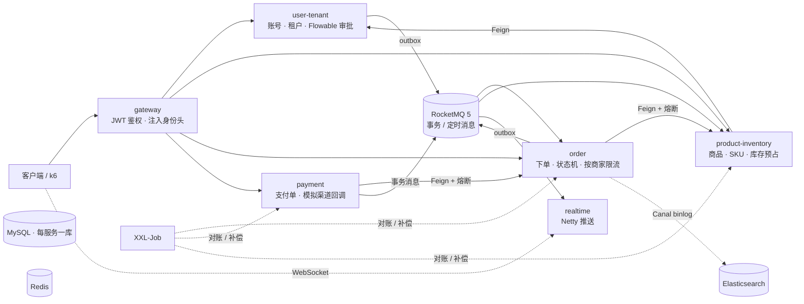

# MerchantHub

[](https://github.com/shqyecho6868-code/merchanthub/actions/workflows/ci.yml)

**中文** | [English](README.en.md)

多商家（多租户）电商交易平台后端。平台 → 商家 → 员工三级租户，买家是平台级用户；覆盖商品与 SKU、库存预占 / 确认 / 释放、订单状态机与交易快照、模拟支付与回调、Flowable 审批、Netty 订单实时推送、ES 订单搜索、对账补偿。学习项目，由分布式 IM 项目改造而来，重点在**交易一致性和多租户隔离的工程做法**，不做前端。

## 架构



更多时序图（下单预占、支付回调四层幂等、超时关单竞争、推送路由）见 [docs/architecture.md](docs/architecture.md)。

## 三个重点

### 1. 订单一致性
- **库存预占 → 确认 → 释放**：`UPDATE ... WHERE available >= ?` 条件更新防超卖；多 SKU 按 ID 升序加锁防死锁；预占记录 `(order_no, sku_id)` 唯一键做幂等
- **状态机 CAS**：所有状态变更 `UPDATE ... WHERE status = 旧状态`，同事务写状态流水；支付成功与超时关单并发时只有一个赢
- **可靠事件**：订单侧本地消息表（outbox）、支付侧 RocketMQ 事务消息（半消息 + 回查）；消费端按 eventId 去重，去重记录与业务同事务
- **回调幂等四层**：支付单快速路径 → 支付单 CAS → 消费去重 → 订单 CAS；关单后到账记 `pay_anomaly` 不复活订单
- **兜底**：悬空预占扫描、支付 ↔ 订单 / 预占 ↔ 订单对账（XXL-Job），修复走正常的幂等链路
- 金额 `long` 分、订单与支付单分离、交易快照、雪花订单号（Redis 租约分配 workerId）

### 2. 多租户
- 网关解析 JWT，**先删客户端同名头**再注入 `X-Tenant-Id / X-User-Id / X-Role`；`/internal/**` 不对外
- `TenantContext` 贯穿 Web / Feign / MQ / 定时任务；MyBatis-Plus 租户插件自动拼 `tenant_id`，**没有上下文直接报错（fail-closed）**
- `@RequireRole` 接口级 RBAC；跨租户访问返回 404（不泄露存在性）
- Sentinel 按商家热点参数限流：大商家打满自己的配额，不影响小商家
- 商家入驻、商品上架走 Flowable 审批，待办按租户候选组隔离

### 3. 实时推送
- Netty WebSocket，握手校验 JWT；Redis Hash + 字段级过期做"用户 → 节点"路由表
- 订单事件集群消费后按路由转发到目标节点（Tag = 节点），多实例下推给正确的连接
- **先存后推**：推送前落"待送达"，写进连接才标记已送达，重连补发

## 技术栈

| 类别 | 选型 |
|---|---|
| 基础 | Java 17 · Spring Boot 3.5 · Spring Cloud 2025 · Spring Cloud Alibaba 2025（Nacos 3） |
| 数据 | MySQL 8（Flyway）· MyBatis-Plus · Redis 7 · Elasticsearch 8 + Canal |
| 消息 / 调度 | RocketMQ 5（事务消息、定时消息）· XXL-Job 3 |
| 治理 | Spring Cloud Gateway · OpenFeign · Sentinel · Micrometer + Prometheus + Grafana |
| 其他 | Flowable 7 · Netty · JJWT |
| 测试 / 交付 | JUnit 5 · Mockito · Testcontainers · JaCoCo · GitHub Actions · k6 |

## 一条命令启动

```bash
cp .env.example .env && docker compose up -d    # 全部中间件（填好 .env 的密码）
./mvnw verify                                    # 构建 + 单测 + Testcontainers 集成测试 + 覆盖率
```

需要 Docker 和 JDK 17（Maven Toolchains 自动选用，见 [docs/env-setup.md](docs/env-setup.md)）。各服务启动、控制台地址、故障排查见 [docs/runbook.md](docs/runbook.md)。

## 测试策略

| 层 | 命名 | 运行 | 内容 |
|---|---|---|---|
| 单元测试 | `*Test` | `./mvnw test`（不需要 Docker） | 状态机、计价、ID 生成、拦截器等纯逻辑 |
| 集成测试 | `*IT` | `./mvnw verify` | Testcontainers 起真实 MySQL / Redis / RocketMQ / ES，镜像版本与 compose 一致 |

- **破坏性实验沉淀成集成测试**：并发超卖、重复回调、消息重复投递 / 乱序、支付与超时竞争、跨租户越权、下游熔断、对账修复等，实验结论写在测试注释里
- **覆盖率门禁**：order、product-inventory、payment 启用 JaCoCo 70% 行覆盖率检查（单测 + 集成测试合并），CI 每次运行在 Summary 页输出各模块覆盖率

| 模块 | 行覆盖率 |
|---|---|
| Common | 56.5% |
| GateWay | 93.0% |
| OrderService | 86.9%（70% 门禁） |
| PaymentService | 91.7%（70% 门禁） |
| ProductInventoryService | 91.6%（70% 门禁） |
| RealTimeService | 86.6% |
| UserService | 85.7% |

> 本地 `./mvnw verify` 2026-11-24 的结果；最新数字以 CI Summary 页为准。

## 压测

工具 k6，脚本与数据检查在 [`perf/`](perf/)，一条命令：`./perf/run.sh perf/k6/scenarios/<场景>.js -e VUS=50 -e DURATION=1m`（步骤见 runbook 3.8）。压完用 `perf/check/check.sh` 校验库存无负数、扣减对账、重复回调只生效一次。

| 场景 | 并发 / 速率 | QPS | P50 | P99 | 错误率 | 数据检查 |
|---|---|---|---|---|---|---|
| （待补） | | | | | | |

单机本地压测（所有服务和中间件在一台笔记本上），数字只用于前后对比，详见 [docs/perf-report.md](docs/perf-report.md)。

## 文档

| 文档 | 内容 |
|---|---|
| [docs/architecture.md](docs/architecture.md) | 架构图与核心链路时序图 |
| [docs/data-model.md](docs/data-model.md) | 表结构、ER 图、订单状态机 |
| [docs/decisions.md](docs/decisions.md) | 技术决策记录（选了什么 / 没选什么 / 代价） |
| [docs/pitfalls.md](docs/pitfalls.md) | 踩坑记录（现象 → 根因 → 解决） |
| [docs/runbook.md](docs/runbook.md) | 启动、控制台、压测、故障排查 |
| [docs/env-setup.md](docs/env-setup.md) | 版本、端口、账号 |
| [docs/progress.md](docs/progress.md) | 进度与遗留问题 |
