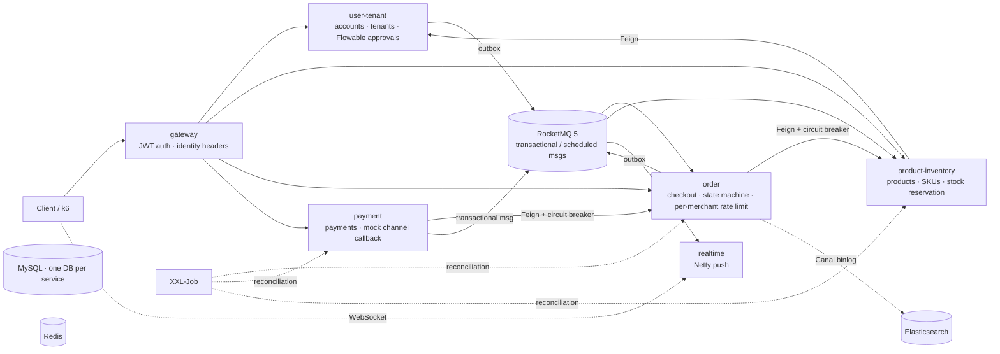

# MerchantHub

[](https://github.com/shqyecho6868-code/merchanthub/actions/workflows/ci.yml)

**English** | [中文](README.zh-CN.md)

Backend of a multi-merchant (multi-tenant) e-commerce trading platform. Tenancy is platform → merchant → staff, with buyers as platform-level users. Covers products & SKUs, inventory reserve / confirm / release, an order state machine with trade snapshots, mock payments with callbacks, Flowable approvals, real-time order push over Netty, order search on Elasticsearch, and reconciliation jobs. A learning project rebuilt from a distributed IM system; the focus is on **the engineering practices behind transactional consistency and tenant isolation**. No frontend.

## Architecture

Sequence diagrams of every core flow (checkout, outbox, payment, timeout, tenant propagation, push, reconciliation): [`docs/architecture.md`](docs/architecture.md). Selected problems and how they were found: [`docs/pitfalls.md`](docs/pitfalls.md).



## Highlights

### 1. Order consistency
- **Reserve → confirm → release** inventory: conditional `UPDATE ... WHERE available >= ?` prevents overselling; multi-SKU rows are locked in ascending ID order to avoid deadlocks; a unique key on `(order_no, sku_id)` makes reservation idempotent
- **State-machine CAS**: every transition is `UPDATE ... WHERE status = <old>` plus a status-log row in the same transaction; when payment success and timeout-close race, exactly one wins
- **Reliable events**: transactional outbox on the order side, RocketMQ transactional messages (half message + check-back) on the payment side; consumers dedupe by eventId inside the business transaction
- **4-layer callback idempotency**: payment fast path → payment CAS → consumer dedupe → order CAS; money arriving after the order is closed goes to `pay_anomaly` instead of resurrecting the order
- **Safety nets**: outbox re-send, timeout close and payment ↔ order / reservation ↔ order reconciliation (XXL-Job); fixes go through the normal idempotent path. An in-process monitor (not on XXL-Job) reports the stale backlog to a CloudWatch alarm and takes over the scan if the scheduler is down
- Amounts in `long` cents, orders separate from payment attempts, trade snapshots, Snowflake order numbers (workerId leased from Redis)

### 2. Multi-tenancy
- The gateway parses the JWT, **strips client-supplied identity headers**, then injects `X-Tenant-Id / X-User-Id / X-Role`; `/internal/**` is never exposed
- `TenantContext` propagates across Web / Feign / MQ / scheduled jobs; a MyBatis-Plus tenant interceptor appends `tenant_id` automatically and **fails closed when no context is set**
- Endpoint-level RBAC via `@RequireRole`; cross-tenant access returns 404 (does not leak existence)
- Sentinel hot-parameter rate limiting per merchant: a big merchant exhausts only its own quota
- Merchant onboarding and product listing go through Flowable approvals, with to-do lists isolated by tenant candidate groups

### 3. Real-time push
- Netty WebSocket with JWT check at handshake; a Redis hash with per-field TTL is the "user → node" routing table
- Order events are consumed in cluster mode and forwarded to the owning node (Tag = node), so pushes reach the right connection with multiple instances
- **Store then push**: a "pending" row is written before delivery and marked delivered only after writing to the connection; replayed on reconnect

### 4. Observability & cloud deployment
- **End-to-end traceId**: the gateway issues `X-Trace-Id` → each service puts it in the MDC → Feign forwards it → it is stored in the outbox and sent as a RocketMQ message property → consumers restore it. One checkout shows the same traceId in the order request thread, the outbox relay thread and the realtime consumer thread
- **AWS in one command**: Terraform manages the VPC, ALB, 6 ECS Fargate services, RDS MySQL, ElastiCache, S3 and CloudWatch (~100 resources). GitHub Actions deploys with OIDC short-lived credentials (no stored access keys): once CI is green it builds images and rolls them out, rolling back automatically if a service fails to start

## Tech stack

| Area | Choice |
|---|---|
| Core | Java 17 · Spring Boot 3.5 · Spring Cloud 2025 · Spring Cloud Alibaba 2025 (Nacos 3) |
| Data | MySQL 8 (Flyway) · MyBatis-Plus · Redis 7 · Elasticsearch 8 + Canal |
| Messaging / scheduling | RocketMQ 5 (transactional & scheduled messages) · XXL-Job 3 |
| Governance | Spring Cloud Gateway · OpenFeign · Sentinel · Micrometer + Prometheus + Grafana |
| Other | Flowable 7 · Netty · JJWT |
| Testing / delivery | JUnit 5 · Mockito · Testcontainers · JaCoCo · GitHub Actions · k6 |
| Cloud | AWS (ECS Fargate · RDS · ElastiCache · ALB · S3 · CloudWatch) · Terraform |

## Quick start

```bash
cp .env.example .env && docker compose up -d    # all middleware (fill in passwords in .env)
./mvnw verify                                    # build + unit tests + Testcontainers ITs + coverage
```

Requires Docker and JDK 17. The build pins JDK 17 through Maven Toolchains, so register one in `~/.m2/toolchains.xml` (type `jdk`, version `17`); any newer default `java` on the PATH is fine.

## Testing strategy

| Layer | Naming | Run | Scope |
|---|---|---|---|
| Unit | `*Test` | `./mvnw test` (no Docker) | state machine, pricing, ID generation, interceptors — pure logic |
| Integration | `*IT` | `./mvnw verify` | real MySQL / Redis / RocketMQ / ES via Testcontainers, same image versions as compose |

- **Destructive experiments are kept as integration tests**: concurrent overselling, duplicate callbacks, duplicate / out-of-order messages, payment-vs-timeout races, cross-tenant access, downstream circuit breaking, reconciliation repair — findings are written in test comments
- **Coverage gate**: order, product-inventory and payment enforce 70% line coverage with JaCoCo (unit + integration merged); every CI run prints per-module coverage on its Summary page

| Module | Line coverage |
|---|---|
| Common | 56.5% |
| GateWay | 93.0% |
| OrderService | 86.9% (70% gate) |
| PaymentService | 91.7% (70% gate) |
| ProductInventoryService | 91.6% (70% gate) |
| RealTimeService | 86.6% |
| UserService | 85.7% |

> From a local `./mvnw verify` on 2026-11-24; the CI Summary page has the latest numbers.

## Load testing

k6 scripts and data checks live in [`perf/`](perf/); one command: `./perf/run.sh perf/k6/scenarios/<scenario>.js -e VUS=50 -e DURATION=1m` (see [`perf/README.md`](perf/README.md)). After each run `perf/check/check.sh` verifies no negative stock, reservation bookkeeping, and that duplicate callbacks took effect only once.

| Scenario | Load | Result | P99 | Data check |
|---|---|---|---|---|
| Per-merchant rate limit | big merchant 100 orders/s (limit 20) + small merchant 5/s | big merchant passed exactly 20/s (1200/6001), rest 429; small merchant 301/301 succeeded | big merchant 72 ms (P50 2.5 ms, mostly rejected at entry); small merchant 86 ms | ✅ successes = orders in DB, no partial data |
| Hot SKU (single stock row) | stepped up to 400 orders/s | ceiling ≈ **240 orders/s** (row lock + commit fsync serialize) | 231 ms at 200/s | ✅ no overselling |
| Spread over 10 SKUs | stepped up to 400 orders/s | stable at 300/s; only 385 at 400/s | 204 ms at 300/s | ✅ |
| Sell-out | stock 500, 2000 concurrent orders | **exactly 500 sold**, 1500 "insufficient stock", 0 errors | 1.57 s | ✅ stock 0, never negative |
| Duplicate payment callbacks | 20 tx/s × 1 min, same callback ×3 concurrently | 1200 tx: PAID 1200 / DUPLICATE 2400 | callback 30 ms | ✅ no double payment or double transition |

Tuning experiment: raising the connection pool from 10 to 30 made throughput worse (COMMIT 6 → 16 ms, row-lock wait ×15) and was reverted — the bottleneck is the database; pool queueing was only the symptom.

Single-machine local test (all services and middleware on one laptop); numbers are for before/after comparison only. Full report with scenario design, bottleneck analysis and cloud results: [`docs/perf-report.md`](docs/perf-report.md).

### On AWS (us-east-1)

One Fargate task per service (0.5 vCPU / 1 GB), RDS db.t4g.micro; k6 runs inside the VPC (4 ms RTT) and goes through ALB → gateway → order.

| Scenario | Result | Bottleneck / observation | Data check |
|---|---|---|---|
| Spread SKUs, stepped load | one order instance tops out at **~50–80 orders/s** (local: 300) | order CPU at 100%; RDS CPU ≤ 23%, write latency < 1 ms. The bottleneck moved from "DB row lock + fsync" locally to "0.5 vCPU app" in the cloud | ✅ no overselling |
| Hot SKU, stepped load | 81 orders/s, 0 errors (local: 240) | same as above — the hot row is no longer the bottleneck in the cloud | ✅ |
| Scale order 1 → 3 | ~110–118 orders/s, **~1.4×** | product-inventory (88% CPU) and the gateway are still single instances; RDS connections hit 58 / 60; **~2 min** from command to new instances taking traffic (Spring needs 80+ s to start on 0.5 vCPU) | ✅ |
| Sustained 200 orders/s overload (no rate limit) | **congestion collapse**: completions stay flat but almost every request hits the 10 s timeout | unbounded queueing; after scaling out, the old instance was still serving requests clients had already abandoned → load shedding at the entry is required | ✅ no lost orders (DB count ≥ k6 successes) |
| Kill 1 of 3 order instances under load | 2.67% errors, recovered in **~40 s**; ECS replaced the task ~1 min later | the error window ≈ the gateway's load-balancer cache (35 s) still holding the dead instance | ✅ no lost orders, no corrupted state; ⚠️ found close events stuck in the outbox (the compensation scan had no scheduler in the cloud) → fixed, next row |
| Outbox safety net: 150 orders/s overload, then XXL-Job stopped | backlog peak 21k drained **~80 s** after load ended (414 rows/s, so 129k ≈ 5 min); with the scheduler down, the in-process monitor took over and drained 9k in **< 2 min** | fast-path drops are counted and logged; the CloudWatch alarm on rows pending > 5 min fired and recovered in all 3 rounds; during overload the scan only reaches 18 rows/s (it competes with checkout for CPU and DB connections) | ✅ 0 undelivered, 0 expired-pending, 0 closed-but-reserved; dangling reservations released by recon |

