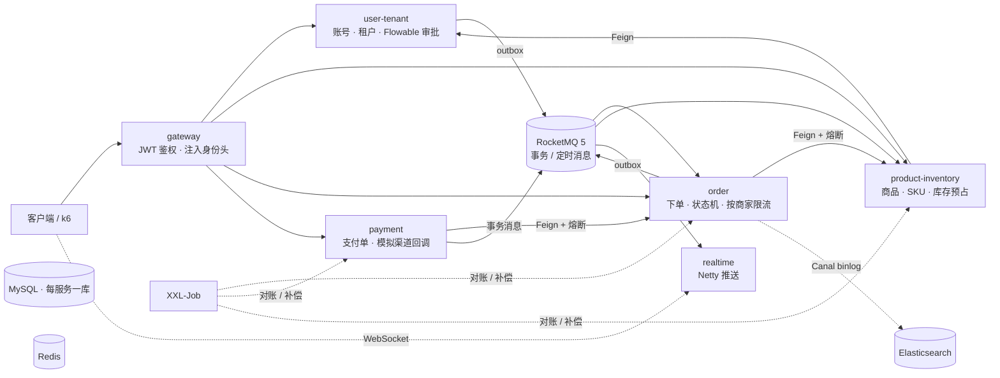

# MerchantHub

[](https://github.com/shqyecho6868-code/merchanthub/actions/workflows/ci.yml)

[English](README.md) | **中文**

多商家（多租户）电商交易平台后端。平台 → 商家 → 员工三级租户，买家是平台级用户；覆盖商品与 SKU、库存预占 / 确认 / 释放、订单状态机与交易快照、模拟支付与回调、Flowable 审批、Netty 订单实时推送、ES 订单搜索、对账补偿。学习项目，由分布式 IM 项目改造而来，重点在**交易一致性和多租户隔离的工程做法**，不做前端。

## 架构



## 三个重点

### 1. 订单一致性
- **库存预占 → 确认 → 释放**：`UPDATE ... WHERE available >= ?` 条件更新防超卖；多 SKU 按 ID 升序加锁防死锁；预占记录 `(order_no, sku_id)` 唯一键做幂等
- **状态机 CAS**：所有状态变更 `UPDATE ... WHERE status = 旧状态`，同事务写状态流水；支付成功与超时关单并发时只有一个赢
- **可靠事件**：订单侧本地消息表（outbox）、支付侧 RocketMQ 事务消息（半消息 + 回查）；消费端按 eventId 去重，去重记录与业务同事务
- **回调幂等四层**：支付单快速路径 → 支付单 CAS → 消费去重 → 订单 CAS；关单后到账记 `pay_anomaly` 不复活订单
- **兜底**：outbox 补发、超时关单、支付 ↔ 订单 / 预占 ↔ 订单对账（XXL-Job），修复走正常的幂等链路；进程内 monitor（不依赖 XXL-Job）把超时积压上报 CloudWatch 告警，调度器挂了就自己接手补发
- 金额 `long` 分、订单与支付单分离、交易快照、雪花订单号（Redis 租约分配 workerId）

### 2. 多租户
- 网关解析 JWT，**先删客户端同名头**再注入 `X-Tenant-Id / X-User-Id / X-Role`；`/internal/**` 不对外
- `TenantContext` 贯穿 Web / Feign / MQ / 定时任务；MyBatis-Plus 租户插件自动拼 `tenant_id`，**没有上下文直接报错（fail-closed）**
- `@RequireRole` 接口级 RBAC；跨租户访问返回 404（不泄露存在性）
- Sentinel 按商家热点参数限流：大商家打满自己的配额，不影响小商家
- 商家入驻、商品上架走 Flowable 审批，待办按租户候选组隔离

### 3. 实时推送
- Netty WebSocket，握手校验 JWT；Redis Hash + 字段级过期做"用户 → 节点"路由表
- 订单事件集群消费后按路由转发到目标节点（Tag = 节点），多实例下推给正确的连接
- **先存后推**：推送前落"待送达"，写进连接才标记已送达，重连补发

### 4. 可观测与云上部署
- **traceId 全链路**：网关生成 `X-Trace-Id` → 各服务放进 MDC → Feign 透传 → 存进本地消息表并写入 RocketMQ 消息属性 → 消费者恢复。一次下单在 order 请求线程、发件箱线程、realtime 消费线程的日志里是同一个 traceId
- **AWS 一键建 / 删**：Terraform 管 VPC、ALB、ECS Fargate × 6、RDS MySQL、ElastiCache、S3、CloudWatch（约 100 个资源）；GitHub Actions 用 OIDC 临时凭证（不存 Access Key），CI 全绿后自动构建镜像、滚动部署，起不来自动回滚

## 技术栈

| 类别 | 选型 |
|---|---|
| 基础 | Java 17 · Spring Boot 3.5 · Spring Cloud 2025 · Spring Cloud Alibaba 2025（Nacos 3） |
| 数据 | MySQL 8（Flyway）· MyBatis-Plus · Redis 7 · Elasticsearch 8 + Canal |
| 消息 / 调度 | RocketMQ 5（事务消息、定时消息）· XXL-Job 3 |
| 治理 | Spring Cloud Gateway · OpenFeign · Sentinel · Micrometer + Prometheus + Grafana |
| 其他 | Flowable 7 · Netty · JJWT |
| 测试 / 交付 | JUnit 5 · Mockito · Testcontainers · JaCoCo · GitHub Actions · k6 |
| 云 | AWS（ECS Fargate · RDS · ElastiCache · ALB · S3 · CloudWatch）· Terraform |

## 一条命令启动

```bash
cp .env.example .env && docker compose up -d    # 全部中间件（填好 .env 的密码）
./mvnw verify                                    # 构建 + 单测 + Testcontainers 集成测试 + 覆盖率
```

需要 Docker 和 JDK 17。构建通过 Maven Toolchains 固定 JDK 17，需在 `~/.m2/toolchains.xml` 登记一个（type `jdk`，version `17`）；PATH 上默认 `java` 版本更高也没关系。

## 测试策略

| 层 | 命名 | 运行 | 内容 |
|---|---|---|---|
| 单元测试 | `*Test` | `./mvnw test`（不需要 Docker） | 状态机、计价、ID 生成、拦截器等纯逻辑 |
| 集成测试 | `*IT` | `./mvnw verify` | Testcontainers 起真实 MySQL / Redis / RocketMQ / ES，镜像版本与 compose 一致 |

- **破坏性实验沉淀成集成测试**：并发超卖、重复回调、消息重复投递 / 乱序、支付与超时竞争、跨租户越权、下游熔断、对账修复等，实验结论写在测试注释里
- **覆盖率门禁**：order、product-inventory、payment 启用 JaCoCo 70% 行覆盖率检查（单测 + 集成测试合并），CI 每次运行在 Summary 页输出各模块覆盖率

| 模块 | 行覆盖率 |
|---|---|
| Common | 56.5% |
| GateWay | 93.0% |
| OrderService | 86.9%（70% 门禁） |
| PaymentService | 91.7%（70% 门禁） |
| ProductInventoryService | 91.6%（70% 门禁） |
| RealTimeService | 86.6% |
| UserService | 85.7% |

> 本地 `./mvnw verify` 2026-11-24 的结果；最新数字以 CI Summary 页为准。

## 压测

工具 k6，脚本与数据检查在 [`perf/`](perf/)，一条命令：`./perf/run.sh perf/k6/scenarios/<场景>.js -e VUS=50 -e DURATION=1m`（步骤见 [`perf/README.md`](perf/README.md)）。压完用 `perf/check/check.sh` 校验库存无负数、扣减对账、重复回调只生效一次。

| 场景 | 压力 | 结果 | P99 | 数据检查 |
|---|---|---|---|---|
| 按商家限流 | 大商家 100 单/秒（阈值 20）+ 小商家 5 单/秒 | 大商家精确通过 20/秒（1200/6001），其余 429；小商家 301/301 成功 | 大商家 72 ms（P50 2.5 ms，多数在入口直接拒）；小商家 86 ms | ✅ 成功数 = 订单数，无半截数据 |
| 热点 SKU（单行库存） | 阶梯到 400 单/秒 | 上限约 **240 单/秒**（行锁 + 提交刷盘串行） | 200 单/秒时 231 ms | ✅ 无超卖 |
| 分散 10 个 SKU | 阶梯到 400 单/秒 | 300 单/秒稳定，400 单/秒时只到 385 | 300 单/秒时 204 ms | ✅ |
| 卖光 | 库存 500，2000 次并发下单 | **正好成交 500**，1500 次"库存不足"，0 错误 | 1.57 s | ✅ 库存 0，无负数 |
| 重复支付回调 | 20 笔/秒 × 1 分钟，同一回调并发 3 次 | 1200 笔：PAID 1200 / DUPLICATE 2400 | 回调 30 ms | ✅ 无重复支付、无重复流转 |

调优实验：把连接池从 10 调到 30，吞吐反而下降（COMMIT 6 → 16 ms，行锁等待 ×15），已回滚。瓶颈在数据库，连接池排队只是症状。

单机本地压测（所有服务和中间件在一台笔记本上），数字只用于前后对比。

### 云上（AWS us-east-1）

每个服务 1 个 Fargate task（0.5 vCPU / 1 GB）、RDS db.t4g.micro；k6 在 VPC 内发压（RTT 4 ms），经 ALB → gateway → order。

| 场景 | 结果 | 瓶颈 / 现象 | 数据检查 |
|---|---|---|---|
| 分散 SKU 阶梯 | 1 个 order 约 **50–80 单/秒**封顶（本地 300） | order CPU 100%；RDS CPU ≤ 23%、写延迟 < 1 ms。瓶颈从本地的"数据库行锁 + 刷盘"变成云上的"0.5 vCPU 应用" | ✅ 无超卖 |
| 热点 SKU 阶梯 | 81 单/秒，0 错误（本地 240） | 同上，云上热点行不再是瓶颈 | ✅ |
| 扩容 order 1 → 3 | 约 110–118 单/秒，**约 1.4 倍** | 下单链路上的 product-inventory（88%）、gateway 仍是单实例；RDS 连接 58 / 60 到顶；下命令到新实例接流量约 **2 分钟**（Spring 在 0.5 vCPU 上启动 80+ 秒） | ✅ |
| 超载 200 单/秒持续（无限流） | **拥塞崩溃**：完成数不降，但几乎全部 10 秒超时 | 请求无限排队，扩容后旧实例仍在处理已被放弃的请求 → 需要入口限流削峰 | ✅ 订单不丢（库里 ≥ k6 成功数） |
| 压测中停 1 个 order（共 3 个） | 错误 2.67%，约 **40 秒**后恢复；ECS 约 1 分钟后补上新 task | 错误窗口 ≈ gateway 负载均衡缓存（35 s）里还留着旧实例 | ✅ 订单不丢、状态不乱；⚠️ 发现关单消息卡在本地消息表（云上没部署补偿扫描调度）→ 已修，见下一行 |
| outbox 兜底：150 单/秒过载，再停掉 XXL-Job | 积压峰值 2.1 万条，负载结束后约 **80 秒**清空（414 条/秒，12.9 万条约 5 分钟）；调度器停掉时，进程内 monitor 接手补发，9 千条 **2 分钟内**清空 | 快路径丢弃有计数和日志；"超过 5 分钟未投递"的 CloudWatch 告警三轮都触发并恢复；过载期间补发只有 18 条/秒（和下单抢 CPU、DB 连接） | ✅ 未投递 0、过期待支付 0、已关闭未释放 0；悬挂预占由对账释放 |

