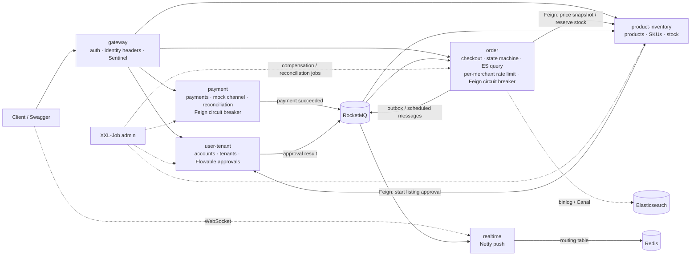
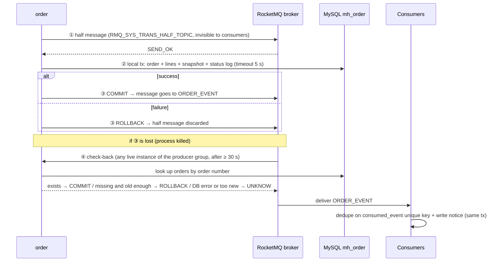
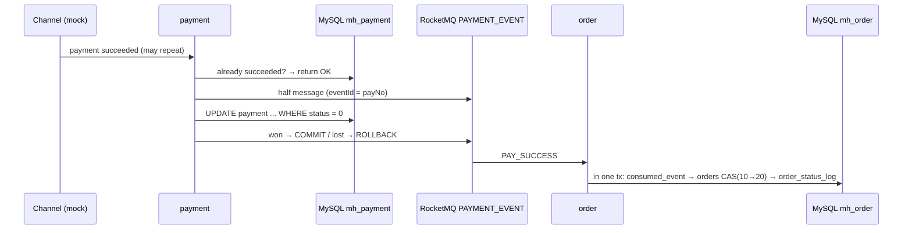
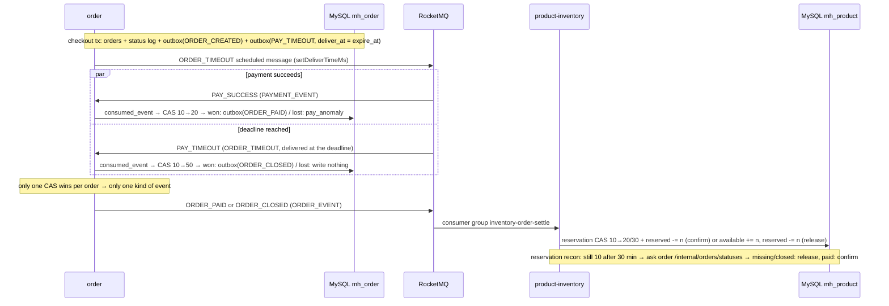
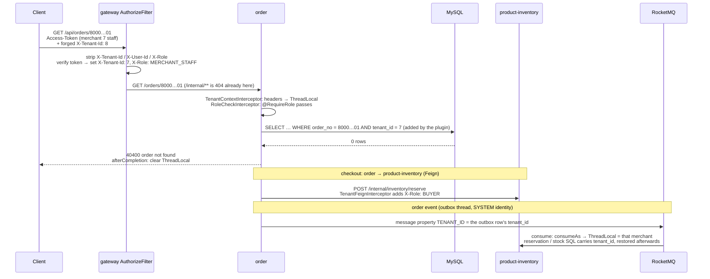
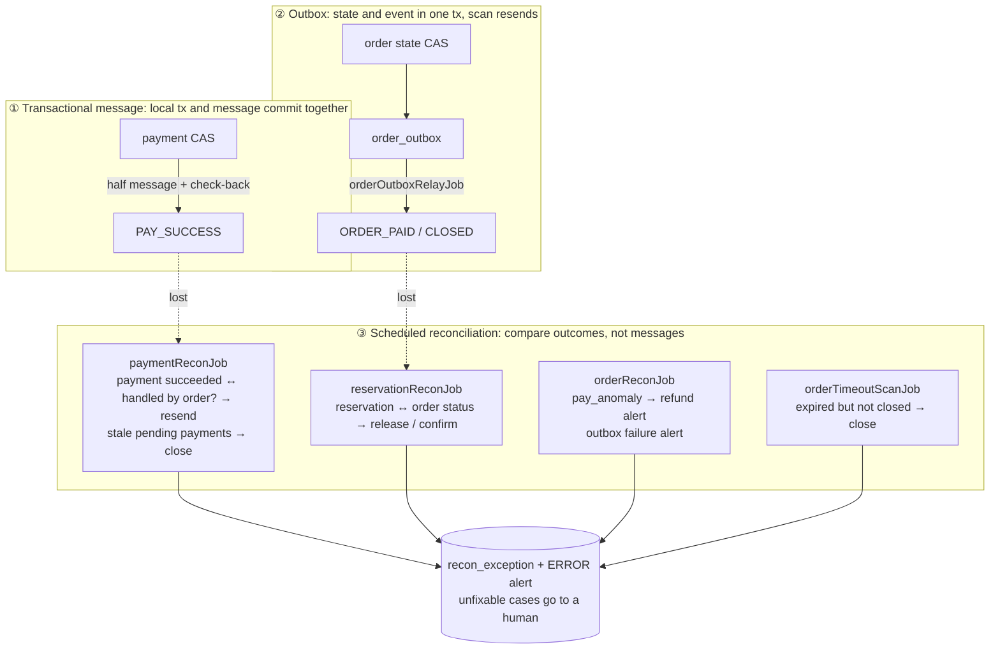
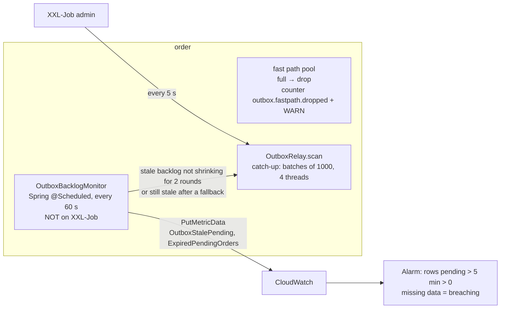

# Architecture

## Services



## Checkout + stock reservation


## Rate limiting at checkout + Feign circuit breaker

```mermaid
sequenceDiagram
    autonumber
    participant B as Buyer
    participant O as order (OrderRateLimiter)
    participant S as Sentinel (in-process)
    participant PI as product-inventory

    B->>O: POST /orders (tenantId=7, items)
    O->>S: SphU.entry("order:create", tenantId=7)
    alt tenant 7 has no tokens left this second (one bucket per merchant, default 20 QPS)
        S-->>O: BlockException
        O-->>B: HTTP 429 + 42900 + Retry-After: 1 (no SKU query, no reservation, no DB)
    else token available
        O->>S: entry("product-inventory:querySkus" / ":reserve")
        alt breaker open (slow-call or error ratio over threshold)
            S-->>O: DegradeException → DOWNSTREAM_UNAVAILABLE (no request sent)
        else normal
            O->>PI: Feign (read timeout 3 s, no automatic retry)
            PI-->>O: result; timeouts / 5xx count toward the breaker, business failures don't
        end
        O->>O: check tenantId matches SKU ownership, save order
        O-->>B: 200 orderNo
    end
```

The Sentinel dashboard is for monitoring and temporary rule changes only; rules are loaded from application.yml at startup and are not persisted.

## "Order created" event: two reliable-publish options

### Option 1: RocketMQ transactional message (`event-mode=TX_MESSAGE`)



### Option 2: transactional outbox (`event-mode=OUTBOX`, default)

```mermaid
sequenceDiagram
    participant O as order
    participant DB as MySQL mh_order
    participant R as OutboxRelay
    participant B as RocketMQ broker
    participant C as Consumers
    O->>DB: one local tx: order … + order_outbox(status=0)
    O->>R: afterCommit → async fast path (pool full → drop, counted + logged)
    loop fast path / scan every 5 s for due status=0 rows
        R->>DB: claim: push next_retry_at forward (lease), send only if 1 row affected
        R->>B: send (plain message, keys = order no, event id)
        alt success
            R->>DB: status=1, sent_at
        else failure
            R->>DB: retry_count+1, backoff 10 s → 20 s → … ≤ 10 min; status=2 + alert after 10 tries
        end
    end
    B->>C: deliver ORDER_EVENT
    C->>C: dedupe on consumed_event unique key + write notice (same tx)
```

## Payment callback → order paid



## Timeout close / payment → confirm or release stock



## Tenant context propagation

A merchant-7 staff member queries an order, and an order event travels through MQ to inventory:



## Product listing approval

The Flowable engine lives only in user-tenant. Merchant-7 staff submit product 1001 → merchant-7 admin reviews → platform admin reviews → the result is written back to product:

```mermaid
sequenceDiagram
    participant S as Merchant 7 staff
    participant P as product-inventory
    participant U as user-tenant (Flowable)
    participant A as Approvers
    participant MQ as RocketMQ
    S->>P: POST /products/1001/listing
    P->>P: tx ①: status 0→1, audit_round=1, status log (committed)
    P->>U: Feign start (outside the tx, idempotent on merchant + product + round)
    U->>U: start instance + insert listing_approval; ACT_RU_TASK: first review (group MERCHANT_ADMIN:7)
    U-->>P: processInstanceId → stored
    A->>U: merchant 7 admin approves → task to history, second review created (group PLATFORM_ADMIN)
    A->>U: platform admin approves
    Note over U: same tx: engine removes runtime task, writes history<br/>+ end listener writes the result + approval_outbox
    U->>MQ: after commit the relay sends PRODUCT_LISTING_RESULT (scan resends on failure)
    MQ->>P: consume: UPDATE ... SET status=2 WHERE status=1 AND audit_round=1 (duplicates hit 0 rows)
    Note over P,U: safety net: under review > 2 min → query the approval → write back with the same CAS / restart if never started
```

Merchant onboarding is local to user-tenant: when the platform admin approves, a ServiceTask creates the tenant and the MERCHANT_ADMIN account in the same transaction; on rejection the same instance waits for the applicant to revise and resubmit, or withdraw.

## Order push: multi-node routing

Merchant-7 staff are connected to node A; ORDER_CREATED is consumed by node B:

```mermaid
sequenceDiagram
    participant M as Merchant 7 staff
    participant A as realtime node A
    participant R as Redis
    participant MQ as RocketMQ
    participant B as realtime node B
    participant DB as MySQL mh_realtime
    M->>A: WebSocket handshake (JWT + compare with the login token in Redis)
    A->>R: HSET rt:route:merchant:7 node-a + HEXPIRE 90s
    A->>DB: resend "pending" rows from offline_message
    loop every 30 s
        M->>A: ping → pong, HEXPIRE renewed
    end
    MQ->>B: ORDER_CREATED (clustered group realtime-order-event)
    B->>DB: tx: consumed_event dedupe + merchant_order_notice
    B->>DB: insert offline_message as "pending" (store before push)
    B->>R: HKEYS rt:route:merchant:7 → {node-a}
    B->>MQ: REALTIME_PUSH, Tag = node-a
    MQ->>A: node-specific group realtime-push-node-a
    A->>M: write to the connection → mark "delivered" on success
    Note over A,R: if A dies: the field stops being renewed and expires after 90 s; messages routed to A meanwhile stay "pending" and are resent when the staff member reconnects elsewhere
```

## Consistency layers and reconciliation



### Watching the safety net itself

All jobs above are triggered by XXL-Job, so XXL-Job is a single point: if it is missing or down, every safety net stops at once (this happened in the cloud, see P56). A second, independent line runs inside order:



- The monitor must not be scheduled by the thing it watches: scheduling it on XXL-Job would make it go silent exactly when XXL-Job is down
- Two drainers at once are safe: `claim` is a conditional UPDATE (one winner per row), consumers dedupe by event id
- The alarm covers what automatic fallback can't fix (e.g. RocketMQ down, or the scan starved during overload): it turns "the system did not heal itself" into "someone knows"

## Cloud deployment (AWS)

Browser → Internet Gateway → **ALB** (public subnets) → **gateway** (Fargate, private subnets) → private IPs from Nacos → order / payment / product-inventory / user-tenant / realtime (one Fargate task each) → **RDS MySQL** / **ElastiCache Redis** (private subnets). Nacos, RocketMQ, Elasticsearch and the XXL-Job admin run on one private EC2 (docker compose); the XXL-Job schema lives on RDS. Product images go to S3 via presigned URLs. Task egress (ECR pulls, CloudWatch) goes through NAT; S3 traffic uses the free gateway endpoint. Custom metrics and alarms are in CloudWatch.

Infrastructure as code in `infra/` (Terraform); the deploy pipeline is `.github/workflows/cd.yml` (GitHub OIDC → ECR → ECS rolling update).
