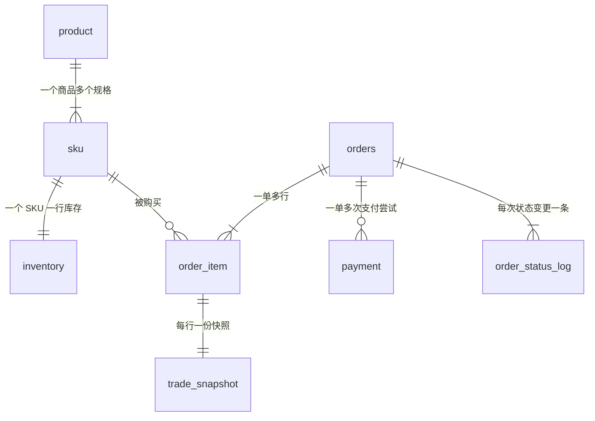
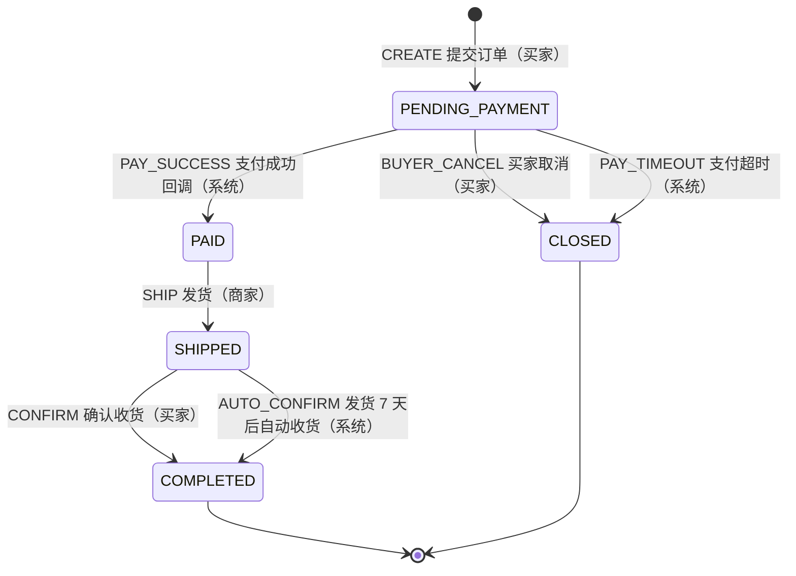

# MerchantHub 数据模型（A3）

> A3 只做设计，不建表。DDL 在 B 组对应任务里落地，字段如果有调整，要回来同步更新本文档。
> 讲解过程和评审记录见 `docs/notes/A3-业务建模.md`。

## 1. 全局约定

| 约定 | 说明 |
|---|---|
| 公共字段 | 每张业务表都有 `tenant_id`、`created_at`、`updated_at`、`deleted`（逻辑删除），下文表格里不重复列出 |
| 金额 | `bigint`，单位分。避免浮点误差，这是行业通行做法 |
| 业务单号 | `order_no`、`pay_no` 用雪花算法生成，不用自增 ID：自增 ID 会暴露业务量，分库以后也不全局唯一 |
| 主键 | `id bigint`，只在内部使用；对外只暴露业务单号 |
| 租户 | `tenant_id` = 商家。买家是平台级用户，用 `buyer_id` 表示，不属于任何租户 |
| 一单一商家 | 本项目没有购物车，一个订单只属于一个商家，不做跨店拆单 |

## 2. ER 关系

## 3. 表结构

### 3.1 product（商品 / SPU）
| 字段 | 类型 | 说明 |
|---|---|---|
| id | bigint PK | |
| name | varchar(128) | 商品名 |
| description | text | 详情描述 |
| main_image | varchar(512) | 主图（MinIO 地址） |
| status | tinyint | 0 草稿 / 1 审核中 / 2 已上架 / 3 已下架 / 4 审核驳回 |

索引：`idx(tenant_id, status)`
设计要点：价格和库存都不放在商品表，因为不同规格的价格、库存可以不一样

### 3.2 sku
| 字段 | 类型 | 说明 |
|---|---|---|
| id | bigint PK | |
| product_id | bigint | 所属商品 |
| sku_code | varchar(64) | 商家自定义编码 |
| spec_json | json | 规格，如 `{"颜色":"白","尺码":"L"}` |
| price | bigint | 售价（分） |
| status | tinyint | 0 停售 / 1 在售 |

索引：`uk(tenant_id, sku_code)`、`idx(product_id)`
设计要点：`sku_code` 只要求在同一商家内唯一，所以唯一索引带上 `tenant_id`

### 3.3 inventory（库存）
| 字段 | 类型 | 说明 |
|---|---|---|
| id | bigint PK | |
| sku_id | bigint | |
| available | int | 可售数量 |
| reserved | int | 预占数量（已下单、未支付） |

索引：`uk(sku_id)`

| 时刻 | available | reserved | 条件 |
|---|---|---|---|
| 下单：预占 | −n | +n | `available >= n` |
| 支付成功：确认扣减 | 不变 | −n | `reserved >= n` |
| 取消/超时：释放 | +n | −n | `reserved >= n` |

设计要点：库存和 SKU 分开存。库存是写多的热点行，SKU 是读多写少的描述信息，拆开以后两者不会抢同一行锁。B 组会加一张库存预占记录表（按订单号记录），用来保证预占和释放的幂等

### 3.4 orders（订单）
| 字段 | 类型 | 说明 |
|---|---|---|
| id | bigint PK | |
| order_no | bigint | 业务订单号 |
| buyer_id | bigint | 买家 |
| status | tinyint | 见第 4 节 |
| total_amount | bigint | 商品总额 |
| discount_amount | bigint | 优惠总额 |
| pay_amount | bigint | 应付 = 总额 − 优惠 |
| expire_at | datetime | 支付截止时间 |
| paid_at / shipped_at / completed_at / closed_at | datetime | 关键时间点 |
| close_reason | varchar(64) | BUYER_CANCEL / PAY_TIMEOUT |

索引：`uk(order_no)`、`idx(tenant_id, status, created_at)`、`idx(buyer_id, created_at)`
表名用 `orders`，因为 `order` 是 SQL 关键字

### 3.5 order_item（订单明细）
| 字段 | 类型 | 说明 |
|---|---|---|
| id | bigint PK | |
| order_no | bigint | |
| product_id / sku_id | bigint | |
| product_name | varchar(128) | 快照冗余 |
| sku_spec | varchar(256) | 快照冗余，如"白色 / L" |
| unit_price | bigint | 快照冗余，下单时的单价 |
| quantity | int | |
| total_amount | bigint | 单价 × 数量 |
| discount_amount | bigint | 分摊到这一行的优惠 |
| pay_amount | bigint | 这一行实付 |
| snapshot_id | bigint | 指向 trade_snapshot |

索引：`idx(order_no)`

### 3.6 payment（支付单）
| 字段 | 类型 | 说明 |
|---|---|---|
| id | bigint PK | |
| pay_no | bigint | 支付单号 |
| order_no | bigint | 关联订单（不唯一） |
| buyer_id | bigint | |
| amount | bigint | 本次支付金额 |
| channel | varchar(32) | 本项目只有 MOCK |
| status | tinyint | 0 待支付 / 1 成功 / 2 失败 / 3 已关闭 |
| channel_trade_no | varchar(64) | 渠道流水号，回调幂等依据 |
| paid_at | datetime | |

索引：`uk(pay_no)`、`idx(order_no)`、`uk(channel_trade_no)`

### 3.7 order_status_log（订单状态流水）
| 字段 | 类型 | 说明 |
|---|---|---|
| id | bigint PK | |
| order_no | bigint | |
| from_status | tinyint | 创建时为 NULL |
| to_status | tinyint | |
| event | varchar(32) | CREATE / PAY_SUCCESS / BUYER_CANCEL / PAY_TIMEOUT / SHIP / CONFIRM / AUTO_CONFIRM |
| operator_type | varchar(16) | BUYER / MERCHANT / SYSTEM |
| operator_id | bigint | 系统操作时为 0 |
| remark | varchar(256) | |

索引：`idx(order_no, created_at)`
设计要点：只插入、不更新，和订单状态的变更在同一个本地事务里写入

### 3.8 trade_snapshot（交易快照）
| 字段 | 类型 | 说明 |
|---|---|---|
| id | bigint PK | |
| order_no | bigint | |
| sku_id | bigint | |
| content | json | 下单那一刻的完整商品信息：名称、规格、价格、描述、图片 |

索引：`idx(order_no)`

## 4. 订单状态机

| 编码 | 状态 | 类型 |
|---|---|---|
| 10 | PENDING_PAYMENT 待支付 | |
| 20 | PAID 已支付 | |
| 30 | SHIPPED 已发货 | |
| 40 | COMPLETED 已完成 | 终态 |
| 50 | CLOSED 已关闭 | 终态 |

### 4.1 流转和副作用

| 事件 | 流转 | 触发者 | 库存 | 其他 |
|---|---|---|---|---|
| CREATE | → 10 | 买家 | 预占 | 写快照，发送超时关单延迟消息 |
| PAY_SUCCESS | 10 → 20 | 系统（支付回调） | 确认扣减 | 支付单 → 成功 |
| BUYER_CANCEL | 10 → 50 | 买家 | 释放 | 关闭未完成的支付单 |
| PAY_TIMEOUT | 10 → 50 | 系统（延迟消息） | 释放 | 关闭未完成的支付单 |
| SHIP | 20 → 30 | 商家 | — | 开始 7 天自动收货计时 |
| CONFIRM / AUTO_CONFIRM | 30 → 40 | 买家 / 系统 | — | |

### 4.2 不合法流转

| 流转 | 原因 |
|---|---|
| 50 → 任何 | 终态。超时关单以后支付回调才到达时，CAS 会失败，订单不能"复活"，要走对账补偿 |
| 40 → 任何 | 终态 |
| 10 → 30 | 跳过了支付 |
| 30 → 50 | 已经发货，不能直接取消（现实中要走退货退款，本项目不做） |
| 20 → 50 | 已经付款，取消必须同时退款，本项目不做退款 |
| 任何往回走的流转 | 状态只能沿定义的方向前进 |

实现方式：`UPDATE orders SET status=? WHERE order_no=? AND status=旧状态`。影响行数为 0 就说明当前状态不对，或者被并发请求抢先改了。改状态和写流水放在同一个事务里

## 5. 设计取舍

| 决策 | 选了 | 没选 | 理由 / 代价 |
|---|---|---|---|
| 库存存放 | 独立的 inventory 表 | 在 SKU 表里加 stock 字段 | 热点写和描述信息分开，减少锁竞争；代价是多一次查询 |
| 库存模型 | available + reserved 两个字段 | 只存一个 stock | 能表达"已下单未付款"的中间态，支持超时释放；代价是每次变更都要同时改两个字段 |
| 减库存时机 | 下单预占，支付确认 | 下单直接扣减 / 付款时扣减 | 下单直接扣：恶意下单不付款会把库存占光；付款时扣：付款时才发现没货，会超卖。预占 + 超时释放兼顾两者 |
| 订单与支付 | 两张表，一对多 | 支付字段放进订单表 | 一个订单可以多次尝试支付；回调按 `pay_no` / `channel_trade_no` 做幂等；代价是多一张表、多一次关联 |
| 快照 | 明细里冗余关键字段 + 独立的快照 JSON 表 | 订单只存 sku_id，展示时再查商品 | 商家改价、改描述、删商品都不影响历史订单；代价是存储有冗余。也可以按内容 hash 去重、多个订单共享一份快照，demo 规模下没有必要 |
| 关闭状态 | 一个 CLOSED + close_reason | CANCELLED / CLOSED 两个终态 | 两者后续处理一样；代价是按原因统计时要查 close_reason |
| 已支付后取消 | 不支持 | 已支付 → 关闭 | 必须同时退款，退款不在本项目范围内；以后做退款时加"退款中"状态 |
| 状态编码 | 10/20/30 间隔编码 | 0/1/2 连续编码 | 以后可以在中间插入新状态（比如 25 退款中） |
