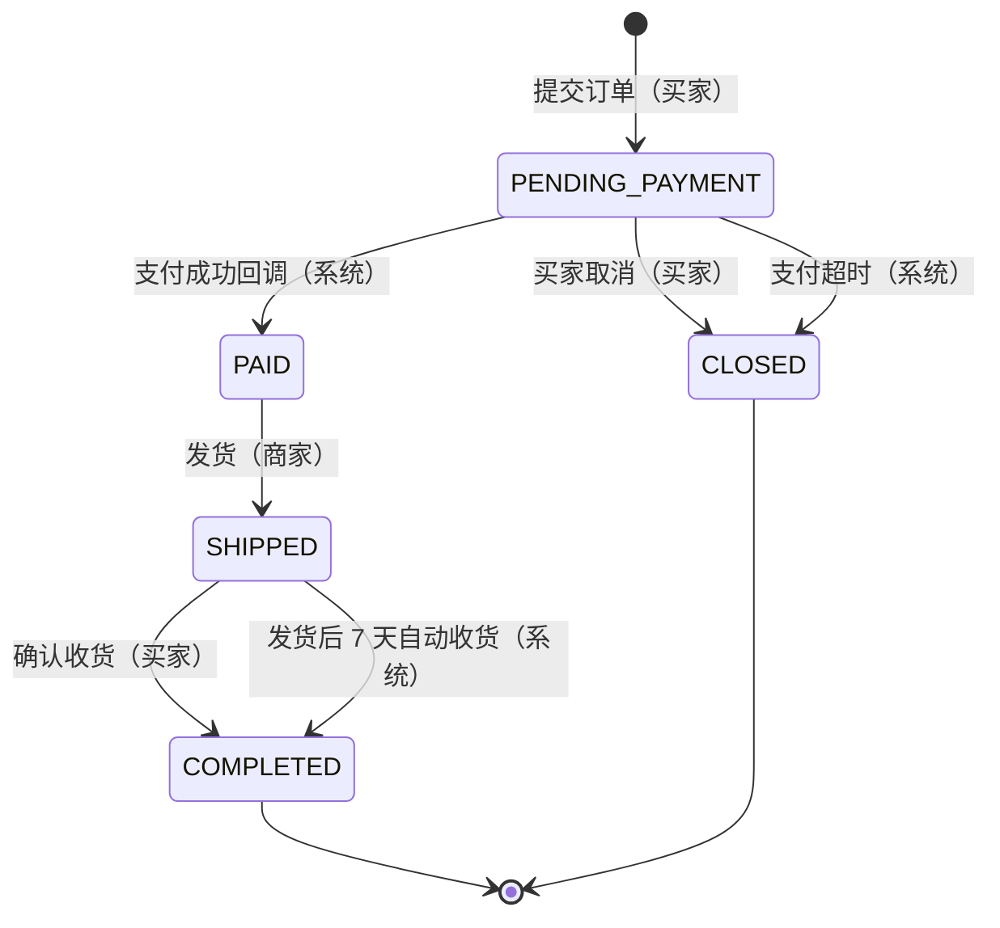

# A3 业务建模：讲解笔记

## 1. 阅读要点

> 只列要点。原文建议自己去找来读；标题我是凭记忆写的，如果搜不到就以这里的要点为准，不要硬找。

### 推荐 1：李玥《后端存储实战课》（极客时间）里讲订单系统数据准确性的那一讲
内容是创建、更新订单时怎么保证数据不出错。要点：

1. **订单是一组表，不是一张表**：订单主表、订单明细、支付记录、物流记录、状态历史，各管各的。主表只放"这一单整体"的信息，比如买家、总金额、状态
2. **防重复提交**：用户连点两下"提交订单"，不能生成两单。行业做法是**先给客户端发一个订单号（或 token），提交时带上**，再用订单号唯一索引兜底。重复请求撞到唯一键就是重复，直接返回第一次的结果
3. **更新防 ABA / 并发覆盖**：两个请求同时改一个订单，后写的会覆盖先写的。做法是用版本号或者 `WHERE status = 旧状态` 做 CAS，影响行数为 0 就说明被别人抢先改了
4. **订单数据只增不删**：取消也只是改状态，不物理删除，因为对账、客诉、审计都要用到历史

### 推荐 2：Stripe 官方博客《Designing robust and predictable APIs with idempotency》
讲支付 API 为什么必须幂等。要点：

1. **网络调用有三种结果**：成功、失败、**不知道**（超时）。"不知道"最危险，客户端只能重试，所以服务端必须保证"重试 N 次 = 执行 1 次"
2. **幂等键（Idempotency Key）**：客户端为每次"意图"生成一个唯一键，服务端按键记录结果，重复的请求直接返回已记录的结果
3. **对本项目的启发**：支付回调可能重复到达、可能乱序到达，所以支付单要有独立的 `pay_no` 和状态，回调处理以它为幂等依据。这也是**订单和支付单要分开**的原因之一，A3 过关时会考

## 2. 读完后带着这几个问题去设计表（第 3 步用）

- 一个商品有"红色 L 码"和"蓝色 M 码"两种规格，价格、库存都不同，你打算存在哪张表？
- 库存的"可售"和"预占"是两个字段，还是一个字段？下单、付款、超时这三个时刻分别怎么变？
- 商家下单后改了商品价格，买家订单详情里显示新价格还是旧价格？靠什么保证？
- 一个订单付款失败，买家换个方式再付，数据库里会多出什么？

## 3. 表结构评审

### 3.0 总评

你做对的地方：
- **商品要带商家 id**：你自己想到了。这其实就是 `tenant_id`，多租户的根
- **商品有 status**：后面商品上架要走 Flowable 审批，所以一定要有状态
- **支付单有独立的支付单号和状态**：方向完全对，这正是"订单和支付单分开"的核心

需要纠正的 4 个概念（按重要程度排）：

| # | 你的理解 | 实际情况 |
|---|---|---|
| 1 | SKU 就是库存 | SKU 说的是"卖的是什么"，库存说的是"还剩多少"，是两件事 |
| 2 | 订单明细和订单一样 | 订单是"一整单"，明细是"这一单里的每一行商品"，是一对多 |
| 3 | 状态流水能被订单表覆盖 | 订单表只存**当前**状态，流水存**历史**（谁、什么时候、为什么改的） |
| 4 | 交易快照记的是支付信息 | 快照记的是**下单那一刻的商品信息**（标题、规格、价格），和支付无关 |

另外还有一个小问题：**主键本来就唯一，不用再给 id 单独建唯一索引**。唯一索引应该建在"业务上不允许重复"的字段上，比如订单号、商家编码。

### 3.1 概念 1：商品（SPU）、SKU、库存

举个例子，商家卖一款"基础款白 T 恤"：

```
商品(SPU)：基础款白T恤                  ← 买家在列表页看到的"一个商品"
  ├─ SKU 1：白色 / L码   价格 59.00元   库存：可售 100，预占 3
  ├─ SKU 2：白色 / M码   价格 59.00元   库存：可售 0，预占 0（卖光了）
  └─ SKU 3：黑色 / L码   价格 69.00元   库存：可售 50，预占 0
```

- **价格放在 SKU 上，不放在商品上**：不同规格价格可以不同（黑色贵 10 块）。你把价格加在商品表上，就表达不了这种情况
- **库存挂在 SKU 上，不挂在商品上**：买家买的是"白色 L 码"，不是笼统的"白 T 恤"。M 码卖光了，L 码照样能卖
- **库存为什么单独一张表，不直接在 SKU 表里加个字段**：
  - SKU 的标题、规格、价格很少改；库存每下一单都要改，是**热点行**
  - 拆开以后，扣库存的 `UPDATE` 只锁库存表的行，商家改商品描述时不会和下单抢同一行锁
  - 这是行业通行做法：商品信息（读多写少）和库存（写多）分开存

### 3.2 概念 2：订单 vs 订单明细

按你原来的设计，订单表里直接放了 `商品id + 数量`，那**一单只能买一种商品**。
买家一次下单买"白色 L ×1 + 黑色 L ×2"，就得拆成两单、付两次钱，这不合理。

```
订单 2025111712000001（商家 A，买家 张三，应付 197.00 元，状态 待支付）
  ├─ 明细 1：白色L  单价 59.00  ×1  小计 59.00
  └─ 明细 2：黑色L  单价 69.00  ×2  小计 138.00
```

- **订单表**存"这一单整体"的信息：谁买的、哪个商家、总金额、状态、各个时间点
- **明细表**存"每一行"：哪个 SKU、单价、数量、小计、**分摊到这一行的优惠**
- 为什么优惠要分摊到行：以后做退款（本项目不做）时，退一件商品要知道这件实际付了多少钱。CLAUDE.md 里定了这一条，现在先把字段留出来

> 本项目没有购物车，一个订单只属于一个商家（一个 `tenant_id`）。淘宝那种"跨店下单拆成多个子订单"的做法不做。

### 3.3 概念 3：为什么需要状态流水

订单表的 `status` 只告诉你**现在**是什么状态。设想一个客诉：

> 买家："我明明付了钱，订单怎么被关闭了？"

只看订单表，你只能看到 `status = 已关闭`。有了流水表，就能看到：

```
10:00:00  NULL     → 待支付   事件=CREATE        操作人=买家
10:15:00  待支付   → 已关闭   事件=TIMEOUT       操作人=系统(超时任务)
10:15:02  （支付回调到达，CAS 失败，订单已经关闭）→ 触发对账/退款处理
```

一眼就能看出是"超时关单和支付回调撞车了"，这正是 B 组要做的破坏性实验。
流水表**只插入、不修改**，相当于订单的审计日志。

### 3.4 概念 4：交易快照记的是什么

设想：买家 10 点下单，买的是"白T恤 L码 59 元，100% 纯棉"。
11 点，商家把这个 SKU 改成了"65% 棉，79 元"。

买家去看订单详情，应该看到**下单那一刻的版本**，否则：
- 价格对不上：订单付了 59，页面显示 79
- 发生纠纷没有证据："你当时写的是纯棉"
- 商家把商品删了，订单详情就打不开了

所以快照存的是**商品信息**，不是支付信息。支付信息本来就在支付单里，不会被别人改。

本项目的做法分两层：
- **订单明细**里冗余存 `商品名、规格、单价`：订单列表页直接用，不用联表
- **交易快照表**存完整的商品信息 JSON（描述、图片、属性）：只有点"查看快照"时才读，避免明细表变得太胖

## 4. 参考设计（评审后的版本）

> 公共字段 `created_at`、`updated_at`、`deleted` 每张表都有，下面不再重复。
> 金额字段全部是 `bigint`，单位是分。

### product（商品 / SPU）
| 字段 | 类型 | 说明 |
|---|---|---|
| id | bigint PK | |
| tenant_id | bigint | 所属商家 |
| name | varchar(128) | 商品名 |
| description | text | 详情描述 |
| main_image | varchar(512) | 主图（MinIO 地址） |
| status | tinyint | 0 草稿 / 1 审核中 / 2 已上架 / 3 已下架 / 4 审核驳回 |

索引：`idx(tenant_id, status)`，用于商家后台按状态查自己的商品

### sku
| 字段 | 类型 | 说明 |
|---|---|---|
| id | bigint PK | |
| tenant_id | bigint | 冗余，方便按租户过滤，不用联表 |
| product_id | bigint | 所属商品 |
| sku_code | varchar(64) | 商家自己的编码 |
| spec_json | json | 规格，如 `{"颜色":"白","尺码":"L"}` |
| price | bigint | 售价（分） |
| status | tinyint | 0 停售 / 1 在售 |

索引：`uk(tenant_id, sku_code)`（同一商家内编码不重复，不同商家可以重复）、`idx(product_id)`

### inventory（库存）
| 字段 | 类型 | 说明 |
|---|---|---|
| id | bigint PK | |
| tenant_id | bigint | |
| sku_id | bigint | 一个 SKU 一行库存 |
| available | int | 可售数量 |
| reserved | int | 预占数量（已下单未付款） |

索引：`uk(sku_id)`

库存在三个时刻的变化（B 组实现）：

| 时刻 | available | reserved | SQL 关键 |
|---|---|---|---|
| 下单（预占） | −n | +n | `WHERE sku_id=? AND available >= n` |
| 支付成功（确认扣减） | 不变 | −n | `WHERE reserved >= n` |
| 超时/取消（释放） | +n | −n | `WHERE reserved >= n` |

> 预告：B 组会加一张"库存预占记录表"（按订单号记录预占了多少），用来保证预占/释放的幂等。A3 先不展开。

### orders（订单，`order` 是 SQL 关键字，所以用复数）
| 字段 | 类型 | 说明 |
|---|---|---|
| id | bigint PK | 内部主键 |
| order_no | bigint | 业务订单号，雪花算法生成，对外暴露 |
| tenant_id | bigint | 商家 |
| buyer_id | bigint | 买家（平台级用户，不属于任何租户） |
| status | tinyint | 见第 5 节状态机 |
| total_amount | bigint | 商品总额 |
| discount_amount | bigint | 优惠总额 |
| pay_amount | bigint | 应付 = 总额 − 优惠 |
| expire_at | datetime | 支付截止时间，超时关单用 |
| paid_at / shipped_at / completed_at / closed_at | datetime | 关键时间点 |
| close_reason | varchar(64) | 关闭原因：买家取消 / 超时 |

索引：`uk(order_no)`、`idx(tenant_id, status, created_at)`（商家查订单）、`idx(buyer_id, created_at)`（买家查订单）

### order_item（订单明细）
| 字段 | 类型 | 说明 |
|---|---|---|
| id | bigint PK | |
| tenant_id | bigint | |
| order_no | bigint | 所属订单 |
| product_id / sku_id | bigint | |
| product_name | varchar(128) | **快照冗余** |
| sku_spec | varchar(256) | **快照冗余**，如"白色 / L" |
| unit_price | bigint | **快照冗余**，下单时的单价 |
| quantity | int | |
| total_amount | bigint | 单价 × 数量 |
| discount_amount | bigint | 分摊到这一行的优惠 |
| pay_amount | bigint | 这一行实付 |
| snapshot_id | bigint | 指向完整快照 |

索引：`idx(order_no)`

### payment（支付单）
| 字段 | 类型 | 说明 |
|---|---|---|
| id | bigint PK | |
| pay_no | bigint | 支付单号，雪花算法 |
| order_no | bigint | 关联订单，**不唯一**：一个订单可以尝试支付多次 |
| tenant_id | bigint | |
| buyer_id | bigint | |
| amount | bigint | 本次支付金额 |
| channel | varchar(32) | 支付方式（本项目只有 MOCK） |
| status | tinyint | 0 待支付 / 1 成功 / 2 失败 / 3 已关闭 |
| channel_trade_no | varchar(64) | 渠道返回的流水号，回调幂等用 |
| paid_at | datetime | |

索引：`uk(pay_no)`、`idx(order_no)`、`uk(channel_trade_no)`

### order_status_log（订单状态流水）
| 字段 | 类型 | 说明 |
|---|---|---|
| id | bigint PK | |
| tenant_id | bigint | |
| order_no | bigint | |
| from_status | tinyint | 创建时为 NULL |
| to_status | tinyint | |
| event | varchar(32) | CREATE / PAY_SUCCESS / CANCEL / TIMEOUT / SHIP / CONFIRM ... |
| operator_type | varchar(16) | BUYER / MERCHANT / SYSTEM |
| operator_id | bigint | 系统操作时为 0 |
| remark | varchar(256) | |

索引：`idx(order_no, created_at)`
只插入不更新：`updated_at`、`deleted` 按规范保留，但实际不会改

### trade_snapshot（交易快照）
| 字段 | 类型 | 说明 |
|---|---|---|
| id | bigint PK | |
| tenant_id | bigint | |
| order_no | bigint | |
| sku_id | bigint | |
| content | json | 下单那一刻的完整商品信息：名称、规格、价格、描述、图片 |

索引：`idx(order_no)`

## 5. 状态图评审

### 5.1 你的 8 条流转逐条看

| # | 你写的 | 评审 |
|---|---|---|
| 1 | 待支付 → 取消｜买家主动取消 | ✅ 对 |
| 2 | 待支付 → 取消｜支付超时｜系统 | ✅ 对。B 组用 RocketMQ 延迟消息实现 |
| 3 | 已发货 → 已完成｜确认收货｜买家 | ✅ 对 |
| 4 | 已发货 → 已完成｜7 天自动收货｜系统 | ✅ 对，你想到了这条，很好。从 `shipped_at` 开始计时 |
| 5 | 待支付 → 已支付｜买家付款｜买家 | ⚠️ 流转对，**触发者不对**，见 5.2 |
| 6 | 已支付 → 已发货｜商家发货 | ✅ 对 |
| 7 | 已支付 → 取消｜商家没货 | ⚠️ 现实中存在，但**本项目做不了**，见 5.3 |
| 8 | 已支付 → 取消｜超时未发货｜系统 | ⚠️ 同上 |
| — | **缺一条**：（无）→ 待支付｜提交订单｜买家 | ❌ 订单是怎么"出生"的也要写进状态图，流水表的第一条就是它 |

### 5.2 为什么"待支付 → 已支付"的触发者是系统，不是买家

买家点"付款"，只是**发起**了一次支付：这时会创建一张支付单，然后跳去支付渠道。
订单真正变成"已支付"，要等**支付渠道回调说"钱到了"**之后。

```
买家点付款 → 创建 payment(待支付) → 去渠道付钱
                                     ↓
              渠道回调 "支付成功" → payment(成功) → 订单 待支付→已支付
```

如果买家点了付款，但钱没付成功（余额不足、中途关掉页面），订单就应该**还是待支付**，买家可以再付一次。
这就是"一个订单对应多张支付单"的由来，也是订单和支付单要分开的原因。

所以第 5 条应该是：`待支付 → 已支付｜支付成功回调｜系统（支付服务）`

### 5.3 为什么本项目不做"已支付 → 取消"

你想得没错，现实里确实有"商家没货"和"超时不发货"的情况。但问题是：**钱已经付了**。
取消一个已支付的订单，必须同时把钱退回去，这就是**退款流程**。CLAUDE.md 第 3 节明确不做退款。

如果只改状态、不退钱，买家的钱就"消失"了。这种流转比没有这条流转更危险。

行业里的做法：已支付订单取消 = 走售后/退款单，状态通常是 `已支付 → 退款中 → 已关闭`，退款单和支付单一样独立建表。
本项目的处理：**不支持这两条流转**，写进 decisions.md，作为"以后做退款时再加"的遗留项。

### 5.4 "取消"和"关闭"用一个状态还是两个

你写的"取消"有两个来源：买家主动取消、系统超时取消。有两种建模方式：
- **A. 一个终态"已关闭"** + `close_reason` 字段（买家取消 / 支付超时）
- **B. 两个终态**："已取消"（人主动）和"已关闭"（系统超时）

本项目推荐 A：两者后续的处理完全一样（都是释放库存、订单不再变化），只是原因不同。原因用字段区分就够了，状态少一个，状态机就简单一些。
代价是：如果以后要按"取消"和"超时"分别统计，就得按 `close_reason` 查，而不是按 `status` 查。

### 5.5 不合法的流转（必须在代码里拦住）

| 流转 | 为什么不合法 |
|---|---|
| 已关闭 → 任何状态 | 终态。**最典型的是：订单已经超时关闭，支付回调才到达**，这时 CAS 会失败，不能把订单"复活"成已支付，要走对账补偿（B 组实验） |
| 已完成 → 任何状态 | 终态 |
| 待支付 → 已发货 | 跳过了付款，商家把货白送了 |
| 已发货 → 已关闭 | 货已经发出去了，买家不能直接取消（现实里要走退货退款） |
| 任何"往回走"的流转，比如 已发货 → 已支付 | 状态只能沿定义的方向走 |

怎么拦：每次改状态都用 `UPDATE orders SET status=新 WHERE order_no=? AND status=旧`，影响行数为 0 就说明当前状态不对（或者被别人抢先改了）。
这就是 CLAUDE.md 里说的 **CAS 状态流转**，B 组实现。

### 5.6 推荐版状态图



状态编码：`10 待支付 / 20 已支付 / 30 已发货 / 40 已完成 / 50 已关闭`
用 10、20 这种间隔编码，是为了以后能在中间插入新状态（比如 25 "退款中"），不用改已有的编码。这是行业常见做法。

## 6. 减库存时机：下单减 vs 付款减 vs 预占

场景：某商家的白T恤 L 码**只剩 1 件**，买家甲、乙先后来买。

### 方案一：下单就扣减（available 直接 −1）
```
10:00 甲下单 → 库存 1→0，甲去付款页面，然后……关掉了页面，一直不付
10:01 乙想买 → 库存 0，显示"已售罄"
结果：东西没卖出去，真想买的人也买不到
```
**问题：恶意占库存（"下单不付款"）**。竞争对手写个脚本下 1000 单不付款，就能让商家的商品全部"售罄"。

### 方案二：付款时才扣减
```
10:00 甲下单 → 库存不变，还是 1
10:01 乙下单 → 库存不变，还是 1（两个人都下单成功了）
10:02 甲付款 → 扣减 1→0 ✅
10:03 乙付款 → 扣减失败……可是乙的钱已经付了
结果：超卖，要么给乙退款（体验差），要么商家变出一件货
```
**问题：超卖**。下单的时候不占库存，就没法保证付款时一定有货。

### 方案三（本项目）：下单预占 + 付款确认 + 超时释放
```
10:00 甲下单 → available 1→0，reserved 0→1（甲占住这一件，15 分钟内付款）
10:01 乙下单 → available = 0，下单失败，提示"暂时无货"
        情况 A：甲 10:05 付款 → reserved 1→0，正式卖出
        情况 B：甲 15 分钟没付 → 超时关单，available 0→1，reserved 1→0，乙可以再买
```
- 不会超卖：下单的时候就已经占住了
- 恶意下单的影响被**限制在超时窗口内**，到时间自动释放
- 代价：多了一个中间状态，要有超时任务（B 组用 RocketMQ 延迟消息），释放和确认都要幂等

**一句话**：下单减怕"占着不买"，付款减怕"付了没货"，预占用"占一段时间、过期归还"折中两者。
