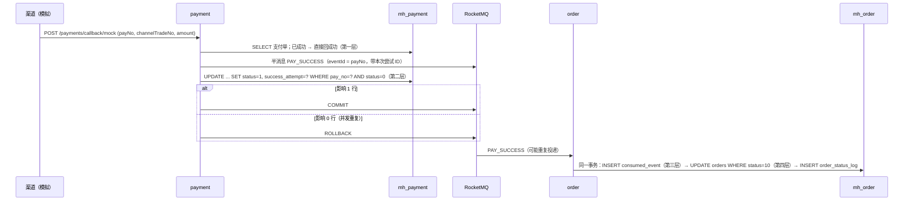

# B3-上｜支付 + 回调幂等 + 订单状态 CAS（2026-11-20）

> 原项目已有（带过）：RocketMQ 收发、事务消息、消费端按 event_id 去重（B2）、Flyway（B2）。
> 本任务新增（重点）：payment 服务；回调幂等；订单状态 CAS + 状态流水；payment → 事件 → order 自己改状态。

## 1. 链路

## 2. 四层挡重复（本任务核心）

| 层 | 位置 | 靠什么 | 挡什么 |
|---|---|---|---|
| ① 快速路径 | payment | 读到支付单已成功 → 直接回成功 | **先后**到达的重复回调（最常见）。不发半消息、不开事务 |
| ② 支付单 CAS | payment | `WHERE status = 0` + 行锁 | **同时**到达的重复回调（都读到 0，穿过①）。只有赢家 COMMIT 半消息 |
| ③ 消费去重 | order | `consumed_event` 唯一键 (group, event_id) | MQ 重投同一事件（at-least-once；事务消息也可能重复提交，见 P19） |
| ④ 订单 CAS | order | `WHERE status = 10` | eventId **不同**但指向同一订单：两张支付单都成功、关单后才到的支付 |

- MQ 本身**不挡**重复，它是制造重复的一环
- 正确性上 ② 一层就够，① 是性能优化（实验里第 6、7 次就是①挡的）
- 🧑 实验结果：并发 5 次 → 1 次 PAID + 4 次被②挡（日志"【幂等·第二层 CAS】"）；之后先后 2 次 → 被①挡；订单流水只有 1 条 PAY_SUCCESS

## 3. 订单状态 CAS（OrderStatusTransitioner）

- `casStatus`：`WHERE order_no AND tenant_id AND status = from`。`status` 防时间上的冲突（并发 / 重复 / 迟到），`tenant_id` 防串租户
- `from` 由**事件**决定（`OrderEvent.PAY_SUCCESS` 固定 10→20），不能"先读当前状态当 from"——读到 50 就会 `WHERE status = 50`，CAS 形同虚设
- 影响 0 行 → **不写流水**、返回 false。流水必须和真实发生的流转一一对应
- `@Transactional(propagation = MANDATORY)`：必须在调用方事务里。否则 CAS 自动提交后流水失败，"已支付却无流水"，且重投时 CAS 失败，流水永远补不回来
- CAS 失败只记 ERROR 并确认消息，不重投：这是确定的业务结果，重投永远不会成功；临时故障（数据库不可用）才抛异常重投
- 不加 `WHERE status` 的后果（两张支付单）：P2 也影响 1 行、返回 true → `paid_at` 被覆盖、流水多一条，**而且不会打"需对账"告警**，P2 的钱被悄悄吞掉。0 行本身就是发现重复支付的信号

### 🔍 审代码 bug
流水 `insert` 写在 `rows != 1` 判断之前 → CAS 失败也写一条 `10→20 PAY_SUCCESS`。后果：两张支付单时流水显示生效两次；关单后才到的支付，订单是 50、流水却写着已支付，"有据可查"失效。测试只断言状态没断言流水条数，所以没抓到；修复后补了断言。

## 4. 本项目特有的取舍

- **payment 用事务消息，order 用本地消息表**（D30）：payment 的本地事务只有一条 CAS，回查只需按 pay_no 查支付单，比再维护 outbox 表 + 扫描简单
- **eventId = payNo**：一张支付单最多成功一次，确定性 ID 让任何重复提交在③被挡住；随机雪花做不到
- **回查比对赢家尝试 ID**（P19）：每次回调生成 UUID 放进半消息，CAS 时写入 `payment.success_attempt`。回查只 COMMIT 赢家的那条
- **payment 不直接改订单**：订单状态只有 order 一个写入方，所有流转都走同一个状态机；payment 调 order 只读（`/internal/orders/{no}`）
- **金额以支付单为准**：建单时从订单取，回调金额不一致直接拒（防"付 1 分钱标成全额已支付"）；order 消费时再校验一次金额和商家
- `channel_trade_no` 唯一键：同一渠道流水不能成功两张支付单（兜底）
- 半消息发不出去（MQ 挂了）：支付单保持待支付、回调返回失败，渠道会重试——不会"钱收了事件丢了"

## 5. 明天（B3-下）预告
超时取消（延迟消息）、取消与支付竞争（同一订单 PAY_TIMEOUT 和 PAY_SUCCESS 谁赢）、库存确认 / 释放、悬空预占、对账补偿（"已关单却支付成功"的退款信号就从今天的 ERROR 日志来）。
